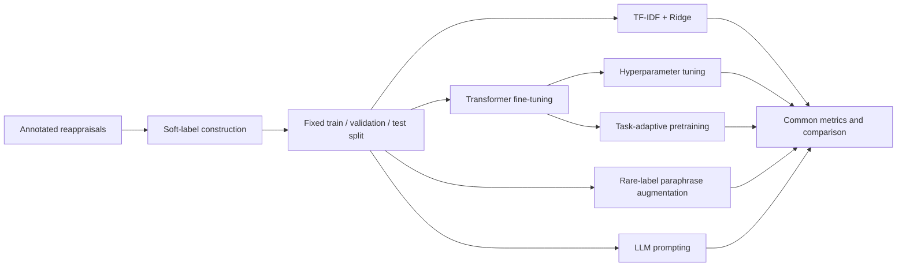

# Reappraisal Classification

This repository studies **multilabel classification of cognitive reappraisal strategies** in short text. Given a situation and a written reappraisal, the models estimate how strongly annotators would associate the response with each of eight strategies.

The repository contains the experiment notebooks and compact result artifacts for classical machine-learning, transformer, task-adaptive pretraining, large-language-model, and multitask approaches.

## Classification task

Each reappraisal can express zero, one, or several strategies:

| Code | Strategy |
|---|---|
| `GM` | Growth mindset |
| `PR` | Positive repurposing |
| `A` | Aberration |
| `EJ` | External justification |
| `N` | Normalizing |
| `UC` | Unwarranted conclusions |
| `V` | Validation |
| `H` | Humor |

The main supervised experiments use **soft labels**: the proportion of valid annotators who marked each strategy as present. Binary metrics are secondary views of the same predictions using three interpretations:

- **Weak presence:** at least one annotator selected the strategy.
- **Majority:** more than half of valid annotators selected it.
- **Strong presence:** at least 80% of valid annotators selected it.

## Repository map

```text
Code/
  TF_IDF/
    TFIDF_Ridge_Baseline.ipynb       Fast classical baseline
    outputs/                          Aggregate metrics and tuning results
  BERT_models/
    notebooks/training/               Training and tuning entry points
    notebooks/analysis/               Result summaries and visualizations
    experiments/baseline/             BERT, BERT Large, and ModernBERT runs
    experiments/lr_epoch_tuning/      Learning-rate and scheduler experiments
    experiments/tapt/
      masked_language_modeling/       RoBERTa TAPT stage
      downstream_comparison/          Standard vs. TAPT classifier results
  LLM/
    llm_model_comparison_baseline.ipynb
    outputs/                          Cached prompting results
  multitask/
    high_roi_multitask_heads_evaluation.ipynb
  paraphrasing/
    Paraphrase_Augmentation_Experiment.ipynb
    Final_AH_One_Per_Source_Augmentation.ipynb
  comparison/
    Model_comparison.ipynb            Cross-family comparison
Data_exploration/
  IRR-reapp-annotations.ipynb         Inter-rater reliability analysis
data/
  README.md                           Data requirements and sharing policy
EXPERIMENTS.md                        Experiment inventory and chronology
MODEL_ARTIFACTS.md                    Model-weight storage notes
```

In general, `notebooks/` contains executable research code and `experiments/` or `outputs/` contains generated metrics, histories, manifests, and figures. The public result artifacts are intentionally small enough to inspect without downloading model checkpoints.

## Experimental approach

The project does not test only one model family. It moves from an interpretable classical baseline to pretrained language models, then asks whether model adaptation or data adaptation adds value. All supervised approaches predict the same eight soft labels and are evaluated on held-out data.



### Approaches and research questions

| Stage | Approach | Question being tested | Evidence in this repository | Status |
|---:|---|---|---|---|
| 1 | Annotation reliability | How consistently do annotators identify each strategy? | Agreement analysis with Gwet's AC1 and Krippendorff's alpha | Analysis present |
| 2 | TF-IDF + Ridge | How far can a fast, interpretable bag-of-words baseline go? | Tuned word n-grams, soft-label regression, and validation-tuned binary thresholds | Completed |
| 3 | Transformer baselines | Do contextual encoders improve on the classical baseline? | BERT Base, BERT Large, and ModernBERT runs across seeds 13 and 42 | Completed |
| 4 | Hyperparameter tuning | How sensitive are the transformers to learning rate, scheduler, and training duration? | Controlled sweeps with early stopping and stored per-epoch histories | Completed |
| 5 | RoBERTa + TAPT | Does additional masked-language-model training on in-domain text improve downstream classification? | Standard and task-adapted RoBERTa compared with the same split and training setup | Completed for the recorded seeds |
| 6 | Paraphrase augmentation | Can label-preserving paraphrases improve the rare `A` and `H` strategies? | Controlled original-versus-augmented protocol with unchanged validation and test sets | Pipeline prepared; final comparison pending |
| 7 | LLM prompting | Can instruction-following models classify the strategies without fine-tuning? | Cached zero-shot and few-shot responses | Partial; aggregate evaluation pending |
| 8 | Multitask learning | Can auxiliary prediction heads improve the shared representation? | Shared-encoder prototype | Scaffold only; training pending |

The main entry points are:

- [TF-IDF baseline](Code/TF_IDF/TFIDF_Ridge_Baseline.ipynb)
- [Transformer experiment runner](Code/BERT_models/notebooks/training/BERT_Soft_Label_Experiment_Runner.ipynb)
- [Learning-rate, scheduler, and epoch tuning](Code/BERT_models/notebooks/training/BERT_Soft_Label_LR_Epoch_Tuning.ipynb)
- [RoBERTa task-adaptive pretraining](Code/BERT_models/notebooks/training/RoBERTa_Masked_Language_Modelling_TAPT.ipynb) and [controlled downstream comparison](Code/BERT_models/notebooks/training/RoBERTa_TAPT_Comparison_Seed13.ipynb)
- [Rare-label paraphrase augmentation](Code/paraphrasing/Final_AH_One_Per_Source_Augmentation.ipynb)
- [LLM prompting comparison](Code/LLM/llm_model_comparison_baseline.ipynb)
- [Multitask prototype](Code/multitask/high_roi_multitask_heads_evaluation.ipynb)
- [Annotation reliability analysis](Data_exploration/IRR-reapp-annotations.ipynb)

### What the hyperparameter experiment tested

The tuning study asked two related questions:

1. **Learning rate:** how large should each optimization step be for each encoder?
2. **Scheduler:** after warmup, should the learning rate decay linearly, follow a cosine curve, or remain constant?

The comparison was controlled: within a model, the data construction, soft-label objective, optimizer, maximum sequence length, evaluation code, and early-stopping rule stayed fixed. Runs used AdamW with weight decay `0.01`, 10% warmup, at most 30 epochs, early-stopping patience 6, and gradient clipping at `1.0`. The best checkpoint was selected by validation loss; test metrics were reported only after checkpoint selection.

The table below describes the configurations that were actually executed and saved. It is intentionally narrower than the larger search space supported by the notebook.

| Model | Learning rates executed | Schedulers executed | Recorded seeds |
|---|---|---|---|
| BERT Base | `5e-6`, `1e-5`, `2e-5`, `3e-5` | Linear | 42 |
| BERT Large | `2e-6`, `5e-6`, `1e-5` | Linear | 42; seeds 13 and 42 for `5e-6` and `1e-5` |
| BERT Large at `1e-5` | `1e-5` | Linear, cosine, constant with warmup | Linear and cosine: 13, 42; constant: 42 |
| ModernBERT Base | `1e-5` | Linear | 42 |
| RoBERTa Large | `1e-5` | Linear | 13, 42 |

The main findings were:

- **Learning rate mattered.** For BERT Base, `3e-5` produced the best soft-label MAE and correlation, while `2e-5` produced the highest majority macro F1. For BERT Large, `1e-5` and `5e-6` were close across the two recorded seeds, while `2e-6` was weaker in its single recorded run.
- **No scheduler dominated every metric.** At BERT Large `1e-5`, linear decay had slightly better replicated MAE, cosine had slightly better replicated validation loss and majority F1, and constant-with-warmup had a promising seed-42 F1 but was not replicated.
- **RoBERTa Large produced the strongest individual run.** Seed 42 at `1e-5` with a linear scheduler reached macro MAE `0.128`, mean Pearson `0.700`, and majority macro F1 `0.570`. Across seeds 13 and 42, the same tuned configuration averaged MAE `0.135 ± 0.009`, Pearson `0.627 ± 0.103`, and majority F1 `0.518 ± 0.074`.
- **Seed variation was substantial.** The gap between the two RoBERTa seeds shows why the best single run should not be interpreted as a stable final estimate. The seed currently controls both the random data split and model initialization.

This was a staged, resource-conscious tuning experiment rather than a fully crossed grid in which every learning rate and scheduler was repeated for every model and seed.

## Experiment tracking and visualisation

The neural experiments produce reproducible local artifacts rather than relying only on notebook output:

- each run records its model configuration, learning rate, scheduler, random seed, best epoch, and evaluation metrics;
- per-epoch training and validation losses are saved as `*_training_history.csv` files;
- early stopping restores the checkpoint with the lowest validation loss;
- the analysis notebooks turn the saved histories into learning curves and cross-run comparison tables; and
- metrics and compact result artifacts remain inspectable without downloading full model checkpoints.

Use [BERT Visualisations](Code/BERT_models/notebooks/analysis/BERT_Visualisations.ipynb) for the full visual analysis and [Important Results Summary](Code/BERT_models/notebooks/analysis/Important_Results_Summary.ipynb) for the condensed comparison. The TAPT workflow additionally exports an MLM loss curve for each run.

> **Possible next improvement — Weights & Biases:** W&B is not currently connected to these notebooks. A useful extension would be to mirror the existing configuration, loss, and metric logs to W&B for live run comparison and optional completion/failure notifications. The committed CSV and JSON files should remain the reproducible source of truth.

## Results at a glance

The table below uses the recorded result artifacts for each model architecture. Macro MAE and mean Pearson evaluate the predicted soft labels. Lower MAE and higher Pearson are better. Binary macro F1 is shown with its target definition because the TF-IDF and transformer experiments do not use exactly the same binary cutoff.

### Current leaders

<table>
  <tr>
    <td align="center" width="33%">
      <strong>Best individual run</strong><br><br>
      <strong>RoBERTa Large</strong><br>
      <code>MAE 0.128 ↓</code><br>
      <code>Pearson 0.700 ↑</code><br>
      <code>Majority F1 0.570 ↑</code><br><br>
      <sub>Seed 42 · LR 1e-5 · linear scheduler</sub>
    </td>
    <td align="center" width="33%">
      <strong>Best replicated soft-label result</strong><br><br>
      <strong>RoBERTa Large</strong><br>
      <code>MAE 0.130 ± 0.004 ↓</code><br>
      <code>Pearson 0.631 ± 0.040 ↑</code><br>
      <code>Majority F1 0.498 ± 0.064 ↑</code><br><br>
      <sub>Controlled first-token setup · seeds 13 and 42</sub>
    </td>
    <td align="center" width="33%">
      <strong>Best lightweight approach</strong><br><br>
      <strong>TF-IDF + tuned Ridge</strong><br>
      <code>MAE 0.163 ↓</code><br>
      <code>Pearson 0.492 ↑</code><br>
      <code>Binary F1 0.400 ↑</code><br><br>
      <sub>Fast classical baseline · binary target differs</sub>
    </td>
  </tr>
</table>

These labels summarize the evidence currently committed to the repository, not a final model ranking. The best individual run should be read alongside the two-seed averages, and TF-IDF's binary F1 is not directly comparable with transformer majority F1.

| Approach | Selected configuration | Seeds | Macro MAE ↓ | Mean Pearson ↑ | Binary macro F1 ↑ | Binary target |
|---|---|---:|---:|---:|---:|---|
| Prevalence baseline | Constant label prevalence | — | — | — | 0.084 | Vote fraction ≥ 0.60 |
| TF-IDF + tuned Ridge | Tuned word 1–2 grams | One split | 0.163 | 0.492 | 0.400 | Vote fraction ≥ 0.60, validation-tuned |
| ModernBERT Base | Original runner, LR `1e-5` | 13, 42 | 0.163 ± 0.001 | 0.443 ± 0.001 | 0.401 ± 0.032 | Majority |
| BERT Base | Linear schedule, LR `3e-5` | 42 | 0.145 | 0.593 | 0.443 | Majority |
| BERT Large | Linear schedule, LR `1e-5` | 13, 42 | 0.142 ± 0.006 | 0.566 ± 0.035 | 0.436 ± 0.038 | Majority |
| RoBERTa Large | Tuned series, linear schedule, LR `1e-5` | 13, 42 | 0.135 ± 0.009 | 0.627 ± 0.103 | **0.518 ± 0.074** | Majority |
| RoBERTa Large | Controlled first-token series, linear schedule, LR `1e-5` | 13, 42 | **0.130 ± 0.004** | **0.631 ± 0.040** | 0.498 ± 0.064 | Majority |
| RoBERTa Large + TAPT | Controlled first-token series, linear schedule, LR `1e-5` | 13, 42 | 0.132 ± 0.003 | 0.620 ± 0.043 | 0.508 ± 0.076 | Majority |

The tuned RoBERTa Large seed-42 run has the strongest individual result on all three headline metrics, but its two-seed standard deviations show meaningful seed sensitivity. In the controlled first-token comparison, standard RoBERTa has the best replicated soft-label metrics, while TAPT has slightly higher majority macro F1. TF-IDF remains a useful lightweight baseline, but its binary F1 is not directly interchangeable with majority F1 because it uses a stricter target definition.

The source artifacts are the [TF-IDF model summary](Code/TF_IDF/outputs/tfidf_model_summary.csv), [per-run transformer results](Code/BERT_models/experiments/lr_epoch_tuning/important_key_results_table.csv), the RoBERTa tuning metrics for [seed 13](Code/BERT_models/experiments/lr_epoch_tuning/roberta_large_lr_1e_05_random_seed13_metrics.json) and [seed 42](Code/BERT_models/experiments/lr_epoch_tuning/roberta_large_lr_1e_05_random_seed42_metrics.json), and the TAPT comparisons for [seed 13](Code/BERT_models/experiments/tapt/downstream_comparison/roberta_large_tapt_comparison_seed13_by_lr.csv) and [seed 42](Code/BERT_models/experiments/tapt/downstream_comparison/roberta_large_tapt_comparison_seed42_by_lr.csv). Values above are rounded to three decimals; `±` values are sample standard deviations across the two listed seeds.

### Does TAPT improve RoBERTa?

The controlled comparison across seeds 13 and 42 gives a mixed result. Values are means with sample standard deviations:

| Variant | Macro MAE ↓ | Mean Pearson ↑ | Weak-presence macro F1 ↑ | Majority macro F1 ↑ | Strong-presence macro F1 ↑ |
|---|---:|---:|---:|---:|---:|
| Standard RoBERTa Large | **0.130 ± 0.004** | **0.631 ± 0.040** | **0.703 ± 0.013** | 0.498 ± 0.064 | **0.416 ± 0.052** |
| RoBERTa Large + TAPT | 0.132 ± 0.003 | 0.620 ± 0.043 | 0.702 ± 0.009 | **0.508 ± 0.076** | 0.399 ± 0.101 |

On average, TAPT raises majority macro F1 by about `0.010`, but it worsens macro MAE by about `0.001` and mean Pearson by about `0.011`; the weak- and strong-presence averages are also slightly lower. TAPT therefore does not provide a consistent overall improvement across the two recorded seeds. The detailed seed-level metrics are in the [seed-13](Code/BERT_models/experiments/tapt/downstream_comparison/roberta_large_tapt_comparison_seed13_by_lr.csv) and [seed-42](Code/BERT_models/experiments/tapt/downstream_comparison/roberta_large_tapt_comparison_seed42_by_lr.csv) comparison tables.

